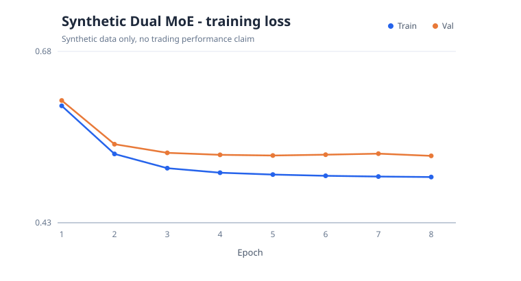
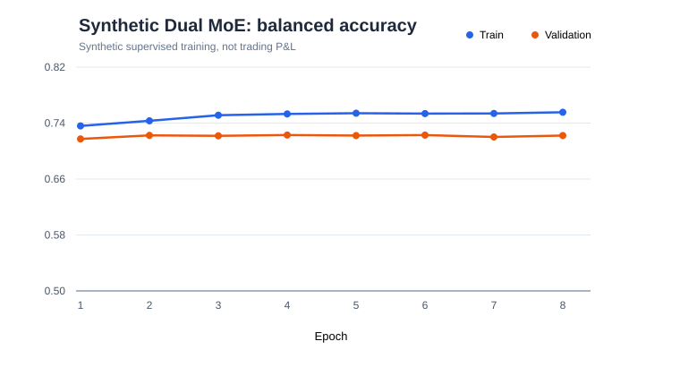

# Market Microstructure: A Small Dual-MoE Experiment

**An inspectable research example for short-horizon equity data, not a trading strategy or profitability claim.**

I investigate different ways of finding an edge in equity markets, including rule-based algorithms, machine learning and reinforcement learning. This repository shows **one approach among many**: a small Dual Mixture-of-Experts (MoE) experiment. I use **NautilusTrader** to validate trading hypotheses and execution behavior against market replay, including order constraints and trading costs. The public demonstration below is separate from that validation and uses **only synthetic L1 quotes and trades**.

## What you can see in two minutes

```text
Seeded synthetic L1 quotes and trades
  -> causal order-book features
  -> chronological train / validation / test + purged horizon
  -> train-only scaling + 12-event windows
  -> MLP expert / GRU expert / learned gate
  -> separate entry and exit heads
  -> training curves + held-out classification result
```

The synthetic generator intentionally plants a weak predictive relationship. Labels are supervised proxies for future price moves and a scripted position state selects the entry/exit head. **This is a compact reconstruction of an architectural idea, not the original RL model, a backtest, or proof of an exploitable market signal.**

## Training progress (synthetic)





With seed 17, 10,000 generated events and eight epochs, the held-out synthetic test balanced accuracy is **0.726**. This measures classification on artificial data; it is **not P&L**, Sharpe, a fill-rate estimate or an out-of-sample result on real market data. Training curves and run configuration are in [the JSON manifest](results/synthetic_run.json).

## The failure worth discussing

An earlier **V15 reinforcement-learning Dual-MoE** checkpoint reported **-$285.56** at step 128. A different checkpoint reported **+$36.25 on one WGRX ticker-day**. These are distinct observations, not a comparable performance curve. The key questions are overtrading, fee sensitivity, concentration of results in individual ticker-days, and whether a policy generalizes to untouched market sessions. The original experiment logs are **not** included here; the figures are explicitly marked as **unverified historical notes** in [failure notes](results/historical_notes.md).

## Run

```bash
python -m venv .venv
.venv/bin/pip install -r requirements.txt
.venv/bin/python demo.py
.venv/bin/python -m pytest -q
```

On Windows, activate the virtual environment and use `python` / `pytest`. The code uses Python, NumPy, PyTorch and Matplotlib. Optional arguments: `--events`, `--epochs`, `--seed`. The script updates `results/synthetic_run.json` and the SVG figures.

## What the checks cover

- Prefix-causal features from bid/ask, displayed depth and signed trade activity
- Chronological partitions with a label-horizon purge and nonoverlapping input windows
- Training-only normalization; no ordinary randomized time-series cross-validation
- Deterministic synthetic input and a seeded experiment manifest
- Tests for generator reproducibility, prefix-causality, split boundaries, model outputs and array shapes

**Next step on real data:** validate chronological ingestion and timestamp alignment, inspect leakage and microstructure anomalies, and use NautilusTrader to replay decisions with realistic maker LIMIT fills, latency, commissions and order expiry. This external validation is **not** bundled or claimed for the toy model.

The goal is to make the setup, limitations and unsuccessful hypotheses easy to inspect in a few minutes.
